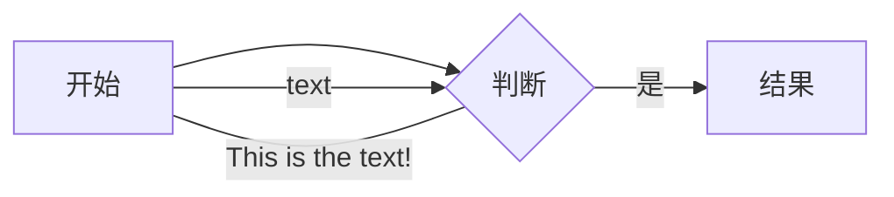
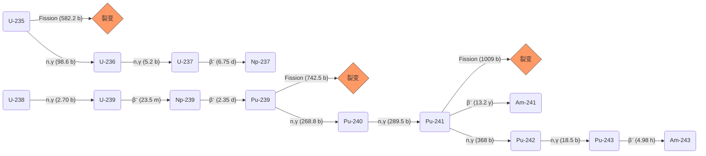

111

---
- [/] 这是一个进行中的任务
- [x] 这是一个已完成的任务
- [!] 这是一个重要的任务
- [?] 这是一个有疑问的任务

> [!faq] 
> 这是一个标注块。

> [!note] 

> [!info] 这是标注的标题
> 这是一个标注块。
> 它支持 **Markdown**、[[内部链接|内部链接]] 和 [[插入文件|嵌入]]！
> 

> 后处理厂

- 事件域（$\sigma$ 代数）：称 $\Omega$ 的某些子集所组成的集合类 $\mathscr{F}$ 为事件域, 如果它满足

    $$
    \left\{ \begin{array}{l} \Omega \in \mathscr {F}, \\ A \in \mathscr {F} \Longrightarrow \overline {{A}} \in \mathscr {F}, \\ A _ {k} \in \mathscr {F} \Longrightarrow \bigcup A _ {k} \in \mathscr {F}. \end{array} \right.
    $$

- 概率的公理化定义：设 $\Omega$ 是一个样本空间，$\mathscr{F}$ 是 $\Omega$ 的某些子集所组成的一个事件域。称定义在 $\mathscr{F}$ 上的一个实值函数 $P: \mathscr{F} \longrightarrow [0,1]$ 为概率，如果它满足：

    $$
    \left\{ \begin{array}{l l} {(\text {非 负 性 公 理})} & {\forall A \in \mathscr {F}, P (A) \geqslant 0,} \\ {(\text {正 则 性 公 理})} & {P (\varnothing) = 0, P (\varOmega) = 1,} \\ {(\text {可 列 可 加 性 公 理})} & {\forall i \neq j, A _ {i} \bigcap A _ {j} = \varnothing , P \left(\bigcup_ {i = 1} ^ {+ \infty} A _ {i}\right) = \sum_ {i = 1} ^ {+ \infty} P (A _ {i}).} \end{array} \right.
    $$

- 概率空间：称 $(\Omega, \mathscr{F}, P)$ 为概率空间。